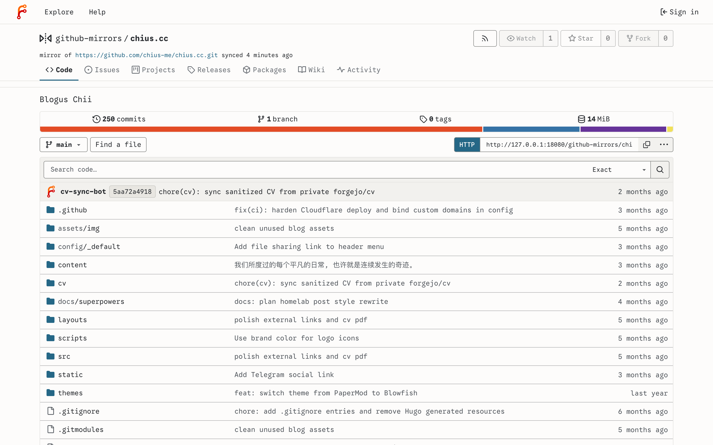
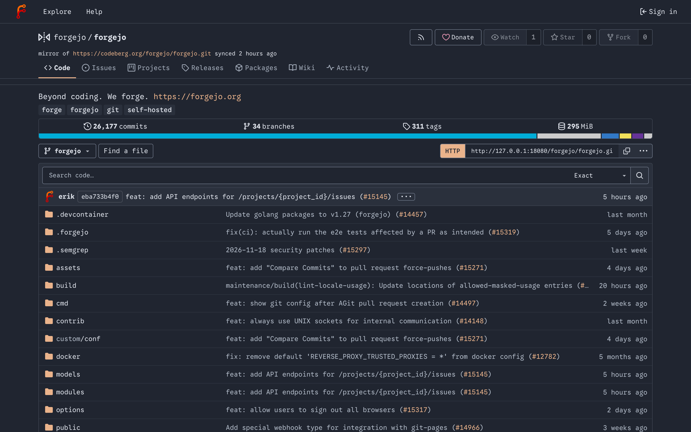
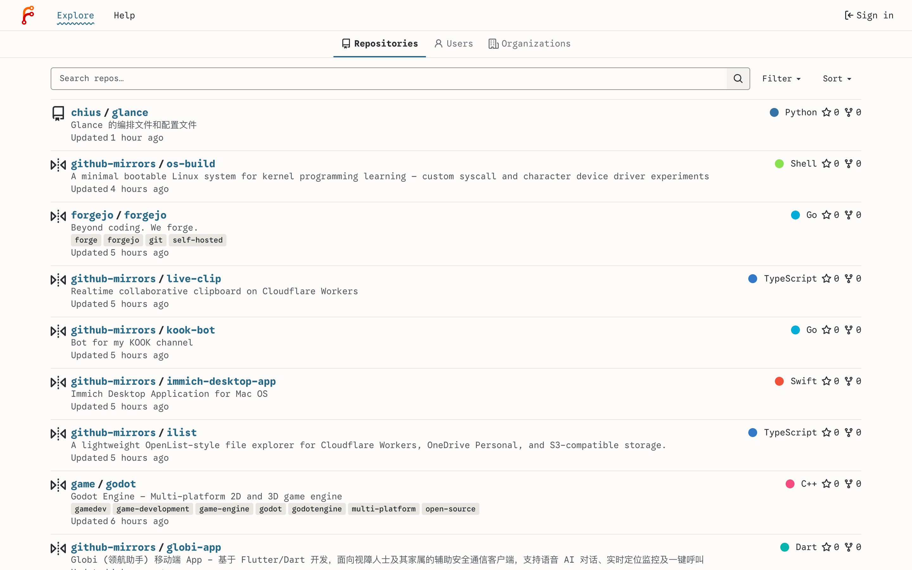
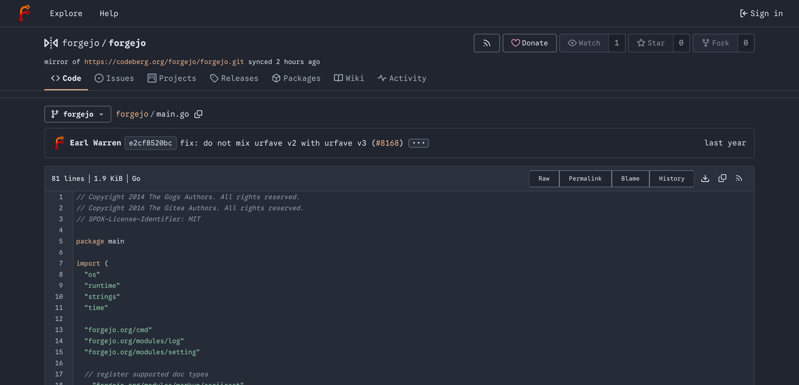

<div align="right">
  <a href="#forgejo-theme-swiss">English</a> | <a href="./README.zh.md">简体中文</a>
</div>

<div align="center">

# forgejo-theme-swiss

Paper Monospace Swiss theme family (Light, Dark, Auto) for [Forgejo](https://forgejo.org/) 17.x.

[](LICENSE)
[](https://forgejo.org/)
[](#variants)
[](#build--customize)

[Preview](#preview) · [Install Guide](INSTALL.md) · [Issues](https://github.com/chius-n/forgejo-theme-swiss/issues)

</div>

Warm paper by day (`#fdfcfb`), slate night by night (`#202530`), `1px` hairline structure, and mixed-script monospace typography.

## Preview

| Light — Repository | Dark — Repository |
| :---: | :---: |
|  |  |

| Light — Explore | Dark — Code View |
| :---: | :---: |
|  |  |

## Variants

| File | Theme ID | Mode | Key Palette |
| --- | --- | --- | --- |
| [`theme-swiss-auto.css`](theme-swiss-auto.css) | `swiss-auto` | Follows OS `prefers-color-scheme` | Imports `light` + `dark` |
| [`theme-swiss-light.css`](theme-swiss-light.css) | `swiss-light` | Warm Paper Light | `#fdfcfb` / `#292c30` / `#256786` / `#b24c37` |
| [`theme-swiss-dark.css`](theme-swiss-dark.css) | `swiss-dark` | Slate Night Dark | `#202530` / `#e1e5ed` / `#eab38b` |

## Design Highlights

- **Dual Paper & Slate Palette**: Light mode achieves `13.69:1` AAA body text on `#fdfcfb` with slate-blue (`#256786`) links and brick-red (`#b24c37`) editorial markers; dark mode pairs `#202530` slate night with `#e1e5ed` text (`12.15:1` AAA) and `#eab38b` warm apricot accents (`8.27:1` AAA).
- **Mixed-Script Monospace Typography**: Uses `Google Sans Code` with fallback to `Sarasa Mono SC`, `PingFang SC`, `Hiragino Sans GB`, and `Microsoft YaHei`, overrides Forgejo's `:lang(...)` proportional font locks, and enforces `tabular-nums` on commit SHAs, line numbers, timestamps, and counters.
- **Hairline Swiss Geometry & Link Grammar**: Removes Fomantic drop-shadow bloat in favor of `1px` borders and `4px` radii; styles active/hovered `#navbar` items with `wavy` underlines, `.markup` links with `dashed` underlines, and blockquotes/list markers with editorial left accents.
- **Full Chroma & CodeMirror Palette**: Maps all 67 Chroma syntax classes and CodeMirror tokens to accessible variables (`>= 4.5:1` AA on `--swiss-code-bg`).
- **Accessibility & Modern Browser UI**: Instant `2px dashed` `:focus-visible` outlines, `scrollbar-color` with `@supports not (scrollbar-color: auto)` WebKit fallbacks, `@media (prefers-reduced-motion: reduce)`, `@media (forced-colors: active)`, and clean `@media print` rules.

## Quick Start

Copy all three stylesheets into Forgejo's `custom/public/assets/css/` directory (see [INSTALL.md](INSTALL.md) for systemd and Docker Compose setup):

```sh
mkdir -p /var/lib/forgejo/custom/public/assets/css
cd /var/lib/forgejo/custom/public/assets/css
curl -fsSLO https://raw.githubusercontent.com/chius-n/forgejo-theme-swiss/main/theme-swiss-auto.css
curl -fsSLO https://raw.githubusercontent.com/chius-n/forgejo-theme-swiss/main/theme-swiss-light.css
curl -fsSLO https://raw.githubusercontent.com/chius-n/forgejo-theme-swiss/main/theme-swiss-dark.css
```

Enable the themes in `app.ini` and restart Forgejo:

```ini
[ui]
DEFAULT_THEME = swiss-auto
THEMES = forgejo-auto,forgejo-light,forgejo-dark,swiss-auto,swiss-light,swiss-dark
```

> `theme-swiss-auto.css` imports `./theme-swiss-light.css` and `./theme-swiss-dark.css`, so all three CSS files must live in the same `assets/css/` directory.

## Build & Customize

Source files live in `src/` and compile into the three root stylesheets with Node.js (zero dependencies):

```sh
node scripts/build.mjs
```

- [`src/tokens-light.css`](src/tokens-light.css) — Warm Paper palette and Forgejo 17.x custom properties
- [`src/tokens-dark.css`](src/tokens-dark.css) — Slate Night palette, Forgejo 17.x custom properties, and dark-only rules
- [`src/swiss-core.css`](src/swiss-core.css) — Shared typography, hairline components, `.markup`, `.chroma`, `.CodeMirror`, accessibility, and print rules
- [`scripts/build.mjs`](scripts/build.mjs) — Concatenates sources and validates light/dark token parity

### Offline / Air-Gapped Deployments

Built stylesheets start with `@import url('https://fonts.googleapis.com/css2?family=Google+Sans+Code:wght@400;500;700&display=swap');`. In offline LAN deployments, browsers fall back to locally installed `Google Sans Code`, `Sarasa Mono SC`, or system monospace fonts, or you can remove that `@import` from [`scripts/build.mjs`](scripts/build.mjs) and rebuild.

## Credits

- Built against Forgejo 17's `theme-forgejo-light.css` and `theme-forgejo-dark.css` custom property interface.
- Multi-file theme layout inspired by [Taylor/forgejo-theme-dracula](https://forge.axfive.net/Taylor/forgejo-theme-dracula).

## License

Distributed under the [MIT License](LICENSE).

---

<div align="center">
  <sub>Crafted with ❤️ by <a href="https://chius.cc">Chius</a></sub>
</div>
