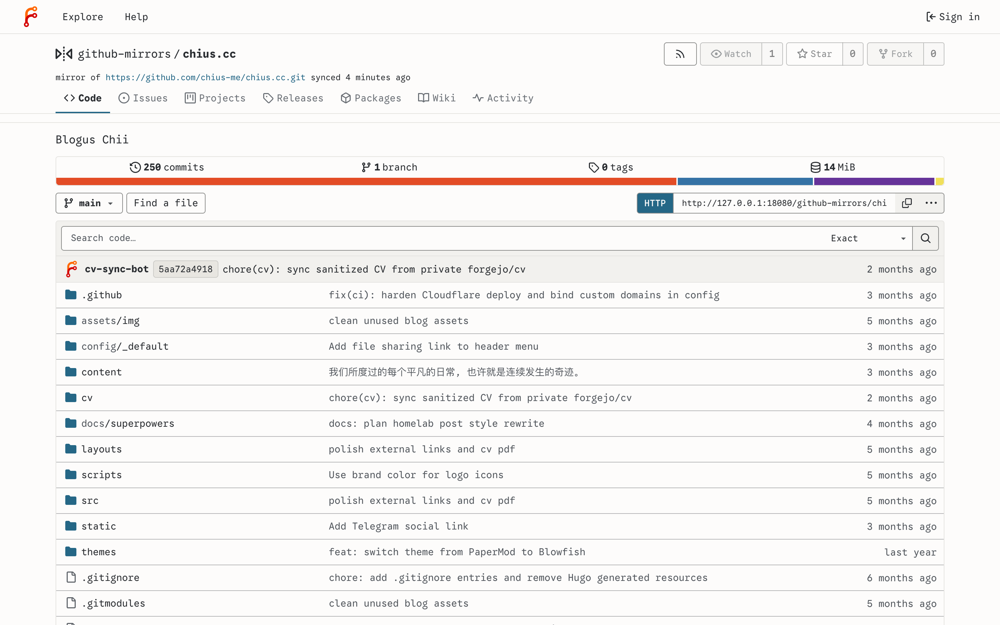
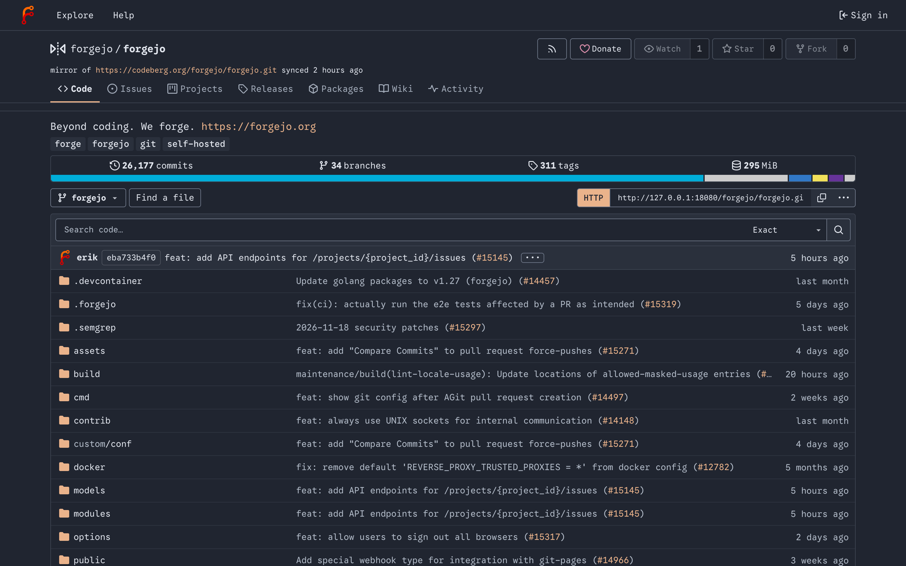
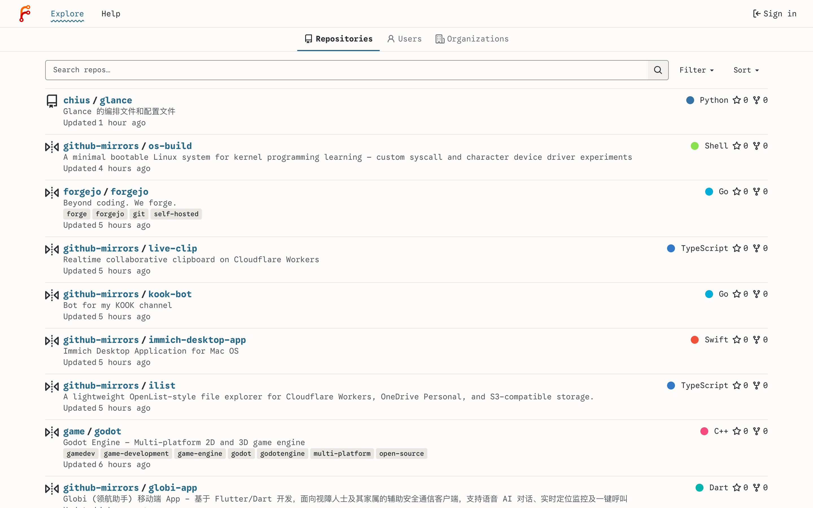
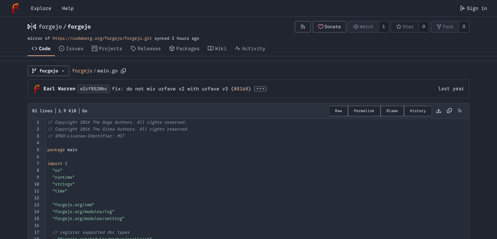

<div align="right">
  <a href="./README.md">English</a> | <a href="#forgejo-theme-swiss">简体中文</a>
</div>

<div align="center">

# forgejo-theme-swiss

面向 [Forgejo](https://forgejo.org/) 17.x 的**纸感等宽瑞士网格**主题家族（浅色、深色、自动跟随）。

[](LICENSE)
[](https://forgejo.org/)
[](#主题变体)
[](#构建与定制)

[效果预览](#效果预览) · [安装指南](INSTALL.md) · [Issues](https://github.com/chius-me/forgejo-theme-swiss/issues)

</div>

白天是暖纸白（`#fdfcfb`），夜晚是蓝灰夜色（`#202530`），配合 `1px` 细线秩序与中英混排等宽字体，设计语言沿用自 [Chipaper](https://github.com/chius-me/chipaper) 与 [swiss-paper-jellyfin](https://github.com/chius-me/swiss-paper-jellyfin)。

## 效果预览

| 浅色模式 — 仓库主页 | 深色模式 — 仓库主页 |
| :---: | :---: |
|  |  |

| 浅色模式 — 探索列表 | 深色模式 — 代码视图 |
| :---: | :---: |
|  |  |

## 主题变体

| 文件 | `app.ini` 主题名 | 模式 | 核心色板 |
| --- | --- | --- | --- |
| [`theme-swiss-auto.css`](theme-swiss-auto.css) | `swiss-auto` | 跟随系统 `prefers-color-scheme` | 自动引入 `light` 与 `dark` |
| [`theme-swiss-light.css`](theme-swiss-light.css) | `swiss-light` | 暖纸浅色 | `#fdfcfb` / `#292c30` / `#256786` / `#b24c37` |
| [`theme-swiss-dark.css`](theme-swiss-dark.css) | `swiss-dark` | 蓝灰深色 | `#202530` / `#e1e5ed` / `#eab38b` |

## 设计特点

- **双主题对比度守恒**：浅色模式主文本在 `#fdfcfb` 上达到 `13.69:1`（AAA），配 `#256786` 链接与 `#b24c37` 砖红点缀；深色模式采用 `#202530` 底配 `#e1e5ed` 文本（`12.15:1` AAA）及 `#eab38b` 暖杏强调色（`8.27:1` AAA）。
- **中英文等宽混排**：以 `Google Sans Code` 为主、回退 `Sarasa Mono SC`、`PingFang SC`、`Hiragino Sans GB` 与 `Microsoft YaHei`，覆盖 Forgejo 内置的 `:lang(...)` 比例字体规则，并为提交哈希、行号、时间与计数启用 `tabular-nums`。
- **瑞士细线与链接语义**：去除 Fomantic-UI 冗余阴影，统一 `1px` 细线与 `4px` 圆角；顶栏悬停/当前项采用 `wavy` 波浪下划线，`.markup` 正文链接使用 `dashed` 虚线，引文竖线与列表圆点使用主题标记色。
- **完整 Chroma 与 CodeMirror 配色**：覆盖 Forgejo 全部 67 个 Chroma 语法类与 CodeMirror 编辑器类，所有语法前景在代码表面上均满足 `>= 4.5:1` AA 对比度。
- **无障碍与现代浏览器适配**：无延迟 `2px dashed` `:focus-visible` 焦点环、标准 `scrollbar-color` 与 `@supports not (scrollbar-color: auto)` WebKit 回退、`prefers-reduced-motion`、`forced-colors` 及干净的 `@media print` 打印视图。

## 快速安装

将三个构建产物全部放入 Forgejo 的 `custom/public/assets/css/` 目录（systemd 与 Docker Compose 完整步骤见 [INSTALL.md](INSTALL.md)）：

```sh
mkdir -p /var/lib/forgejo/custom/public/assets/css
cd /var/lib/forgejo/custom/public/assets/css
curl -fsSLO https://raw.githubusercontent.com/chius-me/forgejo-theme-swiss/main/theme-swiss-auto.css
curl -fsSLO https://raw.githubusercontent.com/chius-me/forgejo-theme-swiss/main/theme-swiss-light.css
curl -fsSLO https://raw.githubusercontent.com/chius-me/forgejo-theme-swiss/main/theme-swiss-dark.css
```

在 `app.ini` 中启用并重启 Forgejo：

```ini
[ui]
DEFAULT_THEME = swiss-auto
THEMES = forgejo-auto,forgejo-light,forgejo-dark,swiss-auto,swiss-light,swiss-dark
```

> `theme-swiss-auto.css` 会相对引入 `./theme-swiss-light.css` 与 `./theme-swiss-dark.css`，三份 CSS 必须放在同一 `assets/css/` 目录下。

## 构建与定制

源码位于 `src/`，通过零依赖 Node 脚本编译输出根目录三份主题 CSS：

```sh
node scripts/build.mjs
```

- [`src/tokens-light.css`](src/tokens-light.css) — 浅色暖纸色板与 Forgejo 17.x 变量映射
- [`src/tokens-dark.css`](src/tokens-dark.css) — 深色蓝灰色板、Forgejo 17.x 变量映射及深色专属规则
- [`src/swiss-core.css`](src/swiss-core.css) — 共享字体、组件细线、`.markup`、`.chroma`、`.CodeMirror`、无障碍与打印样式
- [`scripts/build.mjs`](scripts/build.mjs) — 拼接构建并检查亮/暗变量一致性

### 离线与内网部署说明

生成后的 CSS 首行包含 Google Fonts `@import`；内网无外网环境会自动回退至本地安装的 `Google Sans Code`、`Sarasa Mono SC` 或系统等宽字体，也可从 [`scripts/build.mjs`](scripts/build.mjs) 去掉首行后重新构建。

## 致谢

- 变量体系对齐 Forgejo 17 内置 `theme-forgejo-light.css` 与 `theme-forgejo-dark.css`。
- 配色与版式理念源自 [Chipaper](https://github.com/chius-me/chipaper) 与 [swiss-paper-jellyfin](https://github.com/chius-me/swiss-paper-jellyfin)。
- 多文件自动切换组织方式参考自 [Taylor/forgejo-theme-dracula](https://forge.axfive.net/Taylor/forgejo-theme-dracula)。

## 许可证

基于 [MIT License](LICENSE) 开源发布。

---

<div align="center">
  <sub>Crafted with ❤️ by <a href="https://chius.cc">Chius</a></sub>
</div>
